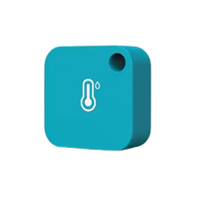
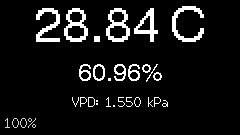
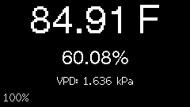

# ESPJaalee
Simple implementation of a Bluetooth app listening for current sensor broadcasts from a Jaalee sensor and displaying the values on the TFT display.

## Setup

Install the ESP32 board support and the `TFT_eSPI` library in Arduino IDE.

`TFT_eSPI` must be configured in the library's setup file because the library is
compiled separately from the sketch. 

Set your device bluetooth address

> const char *const SENSOR_ADDRESS = "AA:AA:AA:AA:AA:AA";

Set the units

> const bool USE_FAHRENHEIT = true; 


## Screenshots





The UI renders into a 16-bit framebuffer (about 63 KiB on the original
240 × 135 T-Display). Only changed text or colours trigger a screen update;
each completed frame is pushed to the LCD without clearing it first.

Upload the updated sketch, connect the board over USB, and close Arduino Serial
Monitor or any other program using its serial port. With `uv` installed, run:

```bash
rtk proxy uv run capture_screen.py --list-ports
rtk proxy uv run capture_screen.py --port /dev/cu.usbserial-XXXX --output screenshot.png
```

Replace the port with the device listed for your board (`COM3`, for example,
on Windows). If exactly one serial device is present, `--port` can be omitted.
`uv` installs the script's pySerial and Pillow dependencies automatically.
Alternatively, install those packages in your Python environment and run the
script with `python3`.

The script sends `s` at 115200 baud and saves the exact framebuffer sent to the
LCD as a PNG. Capture takes roughly six seconds; the screen holds its current
frame during transfer while BLE reception continues. This captures the rendered
pixels, rather than the physical panel's brightness or appearance. Some USB
drivers may reset the board when the port opens; if that happens, capture again
once sensor readings arrive.
